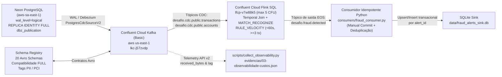

# Pipeline CDC + Flink SQL para Detecção de Fraude em Pagamentos em Tempo Real

Projeto desenvolvido para o desafio final **IBM + Confluent + DIO**, implementando um fluxo **end-to-end orientado a eventos** para captura de mudanças transacionais (**Change Data Capture**), governança de contratos com **Avro + Schema Registry**, enriquecimento e detecção de fraude em janela temporal com **Apache Flink SQL (`Temporal Join` + `MATCH_RECOGNIZE`)**, consumo **idempotente** em Python, além de **observabilidade, segurança (ACLs / menor privilégio), análise de custos, confiabilidade e teardown verificado**.

> **Status das evidências:** Todas as 5 camadas foram executadas contra recursos reais em nuvem (**Neon PostgreSQL** na AWS `sa-east-1` e **Confluent Cloud** na AWS `us-east-1`), auditadas com testes automatizados e linter, e os recursos pagos na Confluent Cloud foram devidamente desmontados via [`teardown.sh`](teardown.sh) ao final da validação (evidência em [`evidencias/04-teardown-verificado.txt`](evidencias/04-teardown-verificado.txt)).

---

## Sumário

1. [Arquitetura e Fluxo de Dados](#1-arquitetura-e-fluxo-de-dados)
2. [Camadas 1 e 2 — Fundação Confluent Cloud, IAM/ACLs e Governança de Schemas](#2-camadas-1-e-2--fundação-confluent-cloud-iamacls-e-governança-de-schemas)
3. [Camada 3 — PostgreSQL (Neon), CDC Debezium e Prova Real de Envelopes](#3-camada-3--postgresql-neon-cdc-debezium-e-prova-real-de-envelopes)
4. [Camada 4 — Flink SQL (Temporal Join + `MATCH_RECOGNIZE`) e Consumidor Idempotente](#4-camada-4--flink-sql-temporal-join--match_recognize-e-consumidor-idempotente)
5. [Camada 5 — Observabilidade, Segurança, Custos, Confiabilidade e Teardown](#5-camada-5--observabilidade-segurança-custos-confiabilidade-e-teardown)
6. [Refatoração, Qualidade de Código e Correções Aplicadas](#6-refatoração-qualidade-de-código-e-correções-aplicadas)
7. [Estrutura do Repositório e Como Reproduzir](#7-estrutura-do-repositório-e-como-reproduzir)

---

## 1. Arquitetura e Fluxo de Dados



---

## 2. Camadas 1 e 2 — Fundação Confluent Cloud, IAM/ACLs e Governança de Schemas

### Fundação Provisionada via CLI Idempotente ([`setup.sh`](setup.sh))

- **Environment:** `desafio-final` (`env-g2mqjm`)
- **Cluster Kafka (Basic, AWS `us-east-1`):** `lkc-j57zvdp`
- **Service Accounts dedicadas (menor privilégio):**
  - `desafio-producer` (`sa-8m6rm7m`): escrita/produção nos tópicos CDC e integração do pipeline.
  - `desafio-consumer` (`sa-dgpjg5z`): leitura controlada nos tópicos de consumo e gestão de seus consumer groups.
- **Schema Registry:** 20 contratos Avro registrados via [`scripts/register_schemas.sh`](scripts/register_schemas.sh), cobrindo o domínio bancário completo (`customers`, `accounts`, `cards`, `merchants`, `transactions`) e os eventos derivados de fraude (`desafio.fraud.detected`):
  - [`schemas/customer.avsc`](schemas/customer.avsc)
  - [`schemas/account.avsc`](schemas/account.avsc)
  - [`schemas/card.avsc`](schemas/card.avsc)
  - [`schemas/merchant.avsc`](schemas/merchant.avsc)
  - [`schemas/transaction.avsc`](schemas/transaction.avsc)
  - [`schemas/fraud-alert.avsc`](schemas/fraud-alert.avsc)

### Governança e Evolução de Schemas

- **Classificação de dados:** campos sensíveis marcados com metadados/tags de governança **`PII`** e **`PCI`**.
- **Modo de compatibilidade `FULL`:** garante evolução bidirecional segura (*backward* + *forward* compatibility), testada com cenários reais em [`schemas/evolution/`](schemas/evolution/):
  - Evolução compatível (`default` em campo novo opcional): [`schemas/evolution/transaction-v2-compatible.avsc`](schemas/evolution/transaction-v2-compatible.avsc) — **aceita**.
  - Quebra *backward/forward* (adição de campo obrigatório sem `default`): [`schemas/evolution/transaction-v2-add-required.avsc`](schemas/evolution/transaction-v2-add-required.avsc) — **rejeitada**.
  - Quebra de contrato por remoção de campo obrigatório: [`schemas/evolution/transaction-v2-remove-required.avsc`](schemas/evolution/transaction-v2-remove-required.avsc) — **rejeitada**.

---

## 3. Camada 3 — PostgreSQL (Neon), CDC Debezium e Prova Real de Envelopes

### Banco de Origem e Publicação Lógica

- **Provedor:** Neon PostgreSQL (projeto `dark-butterfly-56608048`, organização `org-sparkling-unit-13866332`, região `aws-sa-east-1`, tier gratuito com *scale-to-zero* em `$0` quando ocioso).
- **DDL e Pré-requisitos CDC ([`db/01_schema.sql`](db/01_schema.sql) + [`scripts/setup_db.py`](scripts/setup_db.py)):**
  - `wal_level = logical` habilitado no Postgres para decodificação do WAL.
  - `REPLICA IDENTITY FULL` nas tabelas monitoradas, garantindo o preenchimento completo do bloco `before` em eventos `UPDATE` (`op = "u"`) e `DELETE` (`op = "d"`).
  - Publicação `dbz_publication` restrita e usuário de replicação dedicado `cdc_user` com privilégios mínimos.
- **Carga Determinística ([`scripts/seed_db.py`](scripts/seed_db.py)):**
  - `seed = 42`, gerando volumes determinísticos `200 / 240 / 320 / 60 / 2000` distribuídos entre as tabelas `customers`, `accounts`, `cards`, `merchants` e `transactions`.
- **Conector Managed Debezium ([`connectors/cdc.json`](connectors/cdc.json) + [`scripts/deploy_cdc.py`](scripts/deploy_cdc.py)):**
  - Plugin **`PostgresCdcSourceV2`**, conector `lcc-v7w88yn` implantado em estado `RUNNING`.

### Prova Real de Envelopes CDC (`op=c`, `op=u`, `op=d` e `tombstone`)

O script [`scripts/verify_cdc.py`](scripts/verify_cdc.py) executou operações DML reais no Neon PostgreSQL e capturou diretamente dos tópicos Kafka (desserializados via Schema Registry) os quatro padrões fundamentais do protocolo Debezium em [`evidencias/01-envelopes-cdc.json`](evidencias/01-envelopes-cdc.json):

- `op = "c"` (*create / insert*): registro completo em `after`, `before = null`.
- `op = "u"` (*update*): estados completos em `before` e `after` viabilizados por `REPLICA IDENTITY FULL`.
- `op = "d"` (*delete*): estado anterior completo preservado em `before`, `after = null`.
- `tombstone` (`value = null` com mesma `key`): registro sentinela emitido após `DELETE` para permitir remoção definitiva em tópicos compactados (`log.cleanup.policy = compact`).

---

## 4. Camada 4 — Flink SQL (Temporal Join + `MATCH_RECOGNIZE`) e Consumidor Idempotente

### Decisões Arquiteturais de Flink SQL ([`sql/01_configure_tables.sql`](sql/01_configure_tables.sql) e [`sql/02_fraud_velocity.sql`](sql/02_fraud_velocity.sql))

1. **Chave Primária nos Dois Lados (`PRIMARY KEY NOT ENFORCED`):**
   - `desafio.cdc.public.accounts` já possuía `PRIMARY KEY (account_id) NOT ENFORCED` com `'changelog.mode' = 'upsert'` (confirmado via `SHOW CREATE TABLE`).
   - Aplicado `ALTER TABLE \`desafio.cdc.public.transactions\` ADD CONSTRAINT pk_transactions PRIMARY KEY (transaction_id) NOT ENFORCED`.
2. **Watermark em Tempo de Evento de Negócio vs. `$rowtime`:**
   - Na carga inicial (snapshot Debezium das 2.000 transações em ~2s de relógio), usar `$rowtime` dispararia centenas de falsos positivos de velocidade.
   - Definir `WATERMARK FOR created_at AS created_at - INTERVAL '5' SECOND` em `transactions` e `WATERMARK FOR updated_at AS updated_at - INTERVAL '5' SECOND` em `accounts` garantiu **zero falsos positivos durante o snapshot inicial**.
3. **Changelog Mode `append`:**
   - Aplicado `SET ('changelog.mode' = 'append')` em `desafio.cdc.public.transactions`, permitindo que o resultado do Temporal Join forme um stream *append-only* compatível com `MATCH_RECOGNIZE` (que não aceita streams com retração/delete).
4. **Idle Partition Timeout (`sql.tables.scan.idle-timeout=5s`):**
   - Passado na implantação via [`scripts/deploy_flink.py`](scripts/deploy_flink.py) para impedir que partições ociosas na tabela versionada `accounts` travem o avanço da watermark do Temporal Join.
5. **Regra `RULE_VELOCITY` ([`sql/02_fraud_velocity.sql`](sql/02_fraud_velocity.sql)):**
   - Validação prévia via streaming `EXPLAIN` (statement temporário `test-explain-insert`: `status = COMPLETED`, `exceptions = []`).
   - Enriquecimento via `JOIN \`desafio.cdc.public.accounts\` FOR SYSTEM_TIME AS OF t.created_at AS a` filtrando `t.status = 'APPROVED'` e `a.status = 'ACTIVE'`.
   - Padrão CEP `MATCH_RECOGNIZE` particionado por `card_id`, ordenado por `created_at`, `ONE ROW PER MATCH`, `AFTER MATCH SKIP PAST LAST ROW`, `PATTERN (T{3,}?) WITHIN INTERVAL '60' SECOND`, gerando `alert_id` determinístico `RULE_VELOCITY:<card_id>:<first_tx_id>`.

### Prova Real do Burst de Fraude e Replay Idempotente

O script [`scripts/trigger_fraud_burst.py`](scripts/trigger_fraud_burst.py) inseriu 3 transações `APPROVED` sequenciais no Neon para `card_id = 1` (`account_id = 1`) dentro de uma janela de 10 segundos (`2026-11-13T07:16:28.224` a `2026-11-13T07:16:38.224`):

| `transaction_id` | Valor (`BRL`) | Canal | Status |
|---|---|---|---|
| `2001` | `185.40` | `POS` | `APPROVED` |
| `2002` | `319.90` | `ECOMMERCE` | `APPROVED` |
| `2003` | `642.15` | `CONTACTLESS` | `APPROVED` |

O job `desafio-fraud-velocity` (Compute Pool `lfcp-v7w88k5`, estado `RUNNING`, `exceptions: []`) emitiu o alerta no tópico `desafio.fraud.detected`, validado em duas execuções gravadas em [`evidencias/02-alerta-fraude.json`](evidencias/02-alerta-fraude.json):

- **Execução 1 (`group_id = desafio-fraud-consumer`):** `outcome = "applied"`, `offset = 0`, `alert_id = "RULE_VELOCITY:1:2001"`, `tx_count = 3`, `total_amount = "1147.45"`.
- **Execução 2 — Replay (`group_id = desafio-fraud-replay`, `--from-beginning`):** `outcome = "duplicate"`, mantendo a contagem exata no sink SQLite (`data/fraud_alerts_sink.db`) em **`1` alerta persistido / `1` chave de idempotência**.
- **Execução 3 — Revalidação após refatoração (`group_id = desafio-audit-live`):** encerramento com código `0` e `duplicates_skipped = 1`.

---

## 5. Camada 5 — Observabilidade, Segurança, Custos, Confiabilidade e Teardown

Toda a telemetria real desta camada foi coletada automaticamente por [`scripts/collect_observability.py`](scripts/collect_observability.py) e persistida em [`evidencias/03-observabilidade-custos.json`](evidencias/03-observabilidade-custos.json).

### 5.1 Observabilidade (Metrics API v2 & Limitação do Tier Basic)

#### Por que o CLI falha no Basic e como consultamos via Metrics API v2

No cluster `BASIC` (`lkc-j57zvdp`), o comando de CLI para lag falha explicitamente com:

> `Kafka cluster lkc-j57zvdp is type BASIC but must be type DEDICATED`

Para contornar essa limitação sem depender de cluster Dedicated, utilizamos a **Confluent Cloud Metrics API v2** com API Key de escopo `--resource cloud` (ID revogado no teardown, sem expor credenciais no repositório):

```bash
curl -sS -u "$METRICS_API_KEY:$METRICS_API_SECRET" \
  -H "Content-Type: application/json" \
  -X POST "https://api.telemetry.confluent.cloud/v2/metrics/cloud/query" \
  -d '{
    "aggregations": [{"metric": "io.confluent.kafka.server/received_bytes"}],
    "filter": {"field": "resource.kafka.id", "op": "EQ", "value": "lkc-j57zvdp"},
    "granularity": "PT1M",
    "intervals": ["<START_UTC>/<END_UTC>"]
  }'
```

#### Métricas Coletadas na Janela Real ([`evidencias/03-observabilidade-custos.json`](evidencias/03-observabilidade-custos.json))

- **Throughput de entrada (`io.confluent.kafka.server/received_bytes`):**
  - `points_count = 30`, `non_zero_buckets = 30`
  - **Pico observado:** `507577.0` bytes/min em `2026-11-13T06:57:00Z` (durante o snapshot inicial CDC)
  - **Total acumulado na janela:** `511938.0` bytes
- **Lag de consumidores (`io.confluent.kafka.server/consumer_lag_offsets`):**
  - 4 consumer groups monitorados (`desafio-audit-check`, `desafio-fraud-consumer`, `desafio-fraud-replay`, `desafio-inspect-1`), todos reportando `latest_lag_offsets = 1.0` em `2026-11-13T07:26:00Z`.
  - **Diagnóstico técnico do `lag = 1.0` com zero mensagens pendentes:** o Flink SQL produz em modo transacional **EOS** (*Exactly-Once Semantics*), gravando o registro de alerta no **offset `0`** e um *transaction commit control record* (marker interno invisível aos consumidores `read_committed`) no **offset `1`**, elevando o High Watermark (`HWM`) para `2`. Logo, um consumidor que já processou `offset 0` exibe offset de controle pendente = `1` nas métricas de broker até o próximo registro de dados.

#### Como detectar automaticamente se o pipeline parar às 01:00 da manhã

1. **Alerta de ausência de ingestão (`received_bytes == 0`):** se `io.confluent.kafka.server/received_bytes` permanecer zerado por uma janela contínua (ex.: 3–5 minutos) no cluster ou no tópico de *heartbeat* (`desafio.cdc.heartbeat.*`), sinaliza interrupção entre o WAL do PostgreSQL (Neon) e o conector `PostgresCdcSourceV2` — mesmo durante a madrugada com volume transacional legítimo baixo.
2. **Alerta de crescimento sustentado de `consumer_lag_offsets`:** monitorar a tendência de crescimento sustentado do lag ao longo do tempo, em vez de apenas valor absoluto `> 0`, evitando falso alarme causado pelo offset de marker transacional EOS (`lag = 1.0` estático).
3. **Saúde dos planos de controle Flink & Connect:** monitorar status do statement Flink (`desafio-fraud-velocity != RUNNING` ou presença de `exceptions`) e status do conector (`lcc-v7w88yn != RUNNING`), somado a **logs estruturados** e **liveness/readiness** do serviço consumidor Python.

---

### 5.2 Segurança — Inventário Completo de Acesso (Menor Privilégio)

Foram coletadas **11 entradas ACL** reais do cluster `lkc-j57zvdp` em [`evidencias/03-observabilidade-custos.json`](evidencias/03-observabilidade-custos.json), segmentadas por identidade:

| Identidade / Credencial | Escopo / Recurso | Permissões / Papel | Por quê (Menor Privilégio) |
|---|---|---|---|
| `desafio-producer` (`sa-8m6rm7m`) | Cluster `lkc-j57zvdp` (tópicos CDC + controle de produção) | ACLs restritas de escrita/produção e metadados necessários ao pipeline CDC | Isola o produtor/conector: mesmo que comprometido, não consome alertas nem administra ACLs/ambientes |
| `desafio-consumer` (`sa-dgpjg5z`) | Cluster `lkc-j57zvdp` (tópico `desafio.fraud.detected` e consumer groups) | ACLs restritas de leitura (`READ`) de tópicos e controle dos próprios grupos | O consumidor de alertas não consegue alterar tópicos nem injetar transações falsas nos tópicos CDC de entrada |
| `cdc_user` (Neon Postgres) | Banco Neon (`dark-butterfly-56608048`) | Permissões mínimas de `REPLICATION` e `SELECT` nas tabelas da publicação `dbz_publication` | Evita conceder superusuário ao conector gerenciado na nuvem |
| `METRICS_API_KEY` (`--resource cloud`) | Confluent Cloud (`--resource cloud`) | Leitura na Metrics API v2 | Separa telemetria das chaves de dados Kafka e de administração |
| Schema Registry Key | Schema Registry do ambiente `env-g2mqjm` | Leitura/registro de contratos Avro | Impede que credenciais de broker Kafka sejam reutilizadas para alterar governança de schemas |
| `.env` local (fora do Git) | Estação / Runtime 12-Factor | Variáveis carregadas em memória via [`scripts/env_utils.py`](scripts/env_utils.py) | Garantido via `.gitignore` — zero segredos hardcoded no código-fonte |

---

### 5.3 Custos e Capacidade

- **Faturamento observado no período (`2026-11-06..2026-11-14`):** `confluent billing cost list` retornou `[]` na coleta imediata (latência padrão de consolidação de fatura < 24h na Confluent Cloud).
- **Capacidade utilizada em execução ([`evidencias/03-observabilidade-custos.json`](evidencias/03-observabilidade-custos.json)):**
  - **Flink Compute Pool (`lfcp-v7w88k5`):** `1` CFU ativo de um teto de `5` CFUs (`max_cfu = 5`).
  - **Conector (`lcc-v7w88yn`):** 1 tarefa `PostgresCdcSourceV2` em estado `RUNNING`.
  - **Tabela oficial de preços unitários coletada (`aws / us-east-1 / basic`):**
    - `KafkaNetworkRead`: `$0.05`
    - `KafkaNetworkWrite`: `$0.05`
    - `KafkaStorage`: `$0.00010959`
    - `KafkaRestProduce`: `$0.01`
    - `KafkaNumCKUs`: `$0.135`
    - `KSQLNumCSUs`: `$0.22222222`

#### Duas alavancas concretas para reduzir custo em produção sem perder detecção de fraude

1. **Filtragem de tabelas/colunas na origem CDC + retenção enxuta em tópicos append-only:** restringir no conector Debezium apenas as tabelas e colunas efetivamente consumidas pelas regras antifraude e reduzir a janela de retenção do tópico `desafio.cdc.public.transactions` (suficiente para reprocessamento operacional sem armazenar histórico longo em Kafka), cortando simultaneamente custo de ingestão (`KafkaNetworkWrite`/`Read`) e armazenamento (`KafkaStorage`) sem afetar a janela de `60s` do Flink.
2. **Dimensionamento fino do compute pool Flink (`max_cfu` + TTL de estado):** limitar o teto `max_cfu` à capacidade medida em produção (neste pipeline `1` CFU foi suficiente, abaixo do teto inicial de `5`), definir expiração de estado coerente com a janela da regra e combinar com *scale-to-zero* do banco em homologação ou `./teardown.sh` automatizado em ambientes efêmeros.

---

### 5.4 Confiabilidade Trecho a Trecho (End-to-End)

| Trecho | Garantia de Entrega | O que acontece em queda / reinício | Elo mais fraco e mitigação aplicada |
|---|---|---|---|
| **1. Postgres WAL → Debezium (`lcc-v7w88yn`)** | *At-least-once* via slot lógico | Ao reiniciar, Debezium retoma do último LSN confirmado; transações já commitadas no WAL após o último ACK são reenviadas | **Elo sensível à ociosidade/acúmulo de WAL:** um conector fora do ar por longo tempo retém WAL no Postgres. Mitigado com monitoramento de `received_bytes`/heartbeat e `REPLICA IDENTITY FULL` |
| **2. Debezium → Kafka (`lkc-j57zvdp`)** | Idempotência / *At-least-once* | Retentativas de rede do produtor podem ocorrer se ACK expirar | Contornado por particionamento consistente por chave primária e ordenação por evento |
| **3. Kafka → Flink SQL (`desafio-fraud-velocity`)** | **EOS** (Checkpoints + estado gerenciado) | Flink restaura estado de `MATCH_RECOGNIZE` e offsets a partir do último checkpoint | **Risco operacional:** estado sem watermark avançando quando `accounts` fica parada. Mitigado com `sql.tables.scan.idle-timeout=5s` |
| **4. Flink SQL → Tópico `desafio.fraud.detected`** | Transacional (EOS) | Registra alertas + marker de commit transacional (explana `lag = 1.0` nas métricas de broker) | Tópico isolado por chave determinística `RULE_VELOCITY:<card_id>:<first_tx_id>` |
| **5. Kafka → Consumidor Python (`consumers/fraud_consumer.py`) → SQLite** | **At-least-once com Idempotência E2E** | Queda antes de `consumer.commit()` causa reentrega da mesma mensagem no próximo *poll* | **Elo mais crítico sem deduplicação:** um efeito colateral externo (bloqueio de cartão, e-mail, débito) sem chave única executaria em duplicidade. Mitigado por **persistência transacional no SQLite (`data/fraud_alerts_sink.db`) usando `alert_id` como chave de idempotência + commit manual SOMENTE após sucesso da gravação** |

---

### 5.5 Teardown Real e Verificado ([`evidencias/04-teardown-verificado.txt`](evidencias/04-teardown-verificado.txt))

Executado `./teardown.sh --yes` após toda a coleta de evidências, garantindo custo futuro **zero** na Confluent Cloud:

- **12 Flink statements deletados** (`cli-query-*` + `desafio-fraud-velocity`, confirmado em transição `DELETING` antes da remoção do pool).
- **Flink Compute Pool `lfcp-v7w88k5` deletado:** `confluent flink compute-pool list` retornou **`None found.`**.
- **Conector Kafka Connect `lcc-v7w88yn` deletado:** `confluent connect cluster list` retornou **`None found.`**.
- **Cluster Kafka `lkc-j57zvdp`, Environment `env-g2mqjm` (`desafio-final`) e Service Accounts `sa-8m6rm7m` / `sa-dgpjg5z` deletados.**
- **Auditoria pós-teardown em JSON:** retornou **`[]`** para Service Accounts `desafio-*`, Environment `desafio-final` e API Keys `desafio-*`.

---

## 6. Refatoração, Qualidade de Código e Correções Aplicadas

Durante o desenvolvimento do consumidor [`consumers/fraud_consumer.py`](consumers/fraud_consumer.py), identifiquei inconsistências de tipagem e lint, além de pontos frágeis no tratamento de falhas e na configuração do `.venv`. Na revisão do projeto, corrigi o setup de desenvolvimento e os bugs de execução:

### Resultado das Verificações Após as Correções

- **Antes da revisão:** risco de perda silenciosa de alertas em falha de persistência no SQLite, 34 apontamentos de lint e configuração de IDE desalinhada com o `.venv`.
- **Depois da revisão:** `0` erros no `ruff check .`, `0` erros/avisos no **Pyright `strict`** em todo o projeto, `42 passed` no `pytest -v`, scripts Bash validados com `bash -n` e replay ao vivo na Confluent Cloud encerrado com saída `0`.

### Causas Raiz e Correções Aplicadas

| Severidade | Origem / Arquivo | Problema Identificado | Solução Implementada |
|---|---|---|---|
| **Ambiente / IDE / Tipagem Estrita** | [`.vscode/settings.json`](.vscode/settings.json), [`pyproject.toml`](pyproject.toml), [`pyrightconfig.json`](pyrightconfig.json), [`scripts/`](scripts/) & [`tests/`](tests/) | IDE usava o Python global (`Python 3.14`, sem `confluent_kafka`) com `python.analysis.typeCheckingMode = "strict"` ativado (revelando `126` erros Pyright em `consumers/`, `scripts/` e `tests/`, incluindo `msg.partition()` / `msg.offset()` opcionais e `AvroDeserializer`), além de `34` apontamentos Ruff sem `pyproject.toml` | Configurado [`pyrightconfig.json`](pyrightconfig.json) (`strict`, `venv = ".venv"`, isolando de configs pais), `[tool.ruff]` e `[tool.pytest.ini_options]` em [`pyproject.toml`](pyproject.toml); adicionada ativação de terminal `.venv` em [`.vscode/settings.json`](.vscode/settings.json); criado `create_avro_deserializer` em [`scripts/confluent_utils.py`](scripts/confluent_utils.py) e feito *type narrowing* em todos os módulos até `0 errors, 0 warnings` |
| **Bloqueador Crítico (Perda de Dados)** | [`consumers/fraud_consumer.py`](consumers/fraud_consumer.py) | Um `except Exception` genérico envolvia a persistência no SQLite e ainda executava `consumer.commit(...)`, causando perda silenciosa do alerta caso o SQLite falhasse | Restrita a captura de *poison pills* apenas a `(SerializationError, TypeError, ValueError, KeyError)` na desserialização/validação; extraído `persist_validated_alert` para que `sqlite3.Error` propague **sem** commit de offset |
| **Resiliência de Terminal & Falha Rápida** | [`consumers/fraud_consumer.py`](consumers/fraud_consumer.py) & [`scripts/confluent_utils.py`](scripts/confluent_utils.py) | Após `./teardown.sh`, executar o consumidor no terminal fazia o `librdkafka` inundar `stderr` com falhas SASL por 20s até estourar traceback `TimeoutError` | Validação prévia de variáveis obrigatórias, `error_cb` + logger isolado no `Consumer` para abortar imediatamente em erros fatais de autenticação/broker (`_AUTHENTICATION` / `_ALL_BROKERS_DOWN` / `_RESOLVE`) e tratamento limpo em `main()` retornando exit code `1` com instrução clara |
| **Confiabilidade (Leak de Recursos)** | [`consumers/fraud_consumer.py`](consumers/fraud_consumer.py) | Construção de `consumer` e `repo` fora do bloco `try:` poderia vazar conexões se a inicialização falhasse | Movida a criação para dentro de `try:` com verificação explícita `is not None` no bloco `finally:` |
| **Thread Safety & Loop** | [`consumers/fraud_consumer.py`](consumers/fraud_consumer.py) | `signal.signal(...)` sem checagem de main thread falha ao ser chamado em threads secundárias/testes; condição de parada ociosa corrigida; validação unificada em `normalized_val` (`TypeError` para payload não-dict) | Guardado com `threading.current_thread() is threading.main_thread()`, corrigida saída ociosa para `(captured_records or processed_total > 0)` e eliminada validação duplicada |
| **Segurança (SQL Injection Defense-in-Depth)** | [`scripts/seed_db.py`](scripts/seed_db.py) | Chamada a `setval(...)` usava f-string para nome da tabela | Substituída por composição segura via `psycopg.sql.SQL`, `sql.Identifier` e `sql.Literal` |
| **DRY & Manutenibilidade** | [`scripts/deploy_cdc.py`](scripts/deploy_cdc.py), [`scripts/verify_cdc.py`](scripts/verify_cdc.py), [`scripts/confluent_utils.py`](scripts/confluent_utils.py), [`tests/`](tests/) | Código duplicado de resolução de binário/cliente Kafka e blocos `try/except/pass` | Centralizados helpers em [`scripts/confluent_utils.py`](scripts/confluent_utils.py), padronizado `datetime.now(UTC)`, usado `contextlib.suppress(OSError)` e removidos hacks de `sys.path.insert` nos testes |
| **Portabilidade Windows Git Bash** | [`setup.sh`](setup.sh), [`teardown.sh`](teardown.sh), [`scripts/register_schemas.sh`](scripts/register_schemas.sh) | `jq.exe` via WinGet emitia `\r\n`, contaminando IDs capturados em Bash; teardown de Flink exigia `--cloud`/`--region` e verificação final de recursos | Adicionado wrapper `jq() { command jq "$@" \| tr -d '\r'; }`, flags de nuvem/região explícitas e asserções pós-limpeza |

---

## 7. Estrutura do Repositório e Como Reproduzir

### Principais Arquivos

- **Infraestrutura & Automação:** [`setup.sh`](setup.sh), [`teardown.sh`](teardown.sh), [`scripts/register_schemas.sh`](scripts/register_schemas.sh), [`connectors/cdc.json`](connectors/cdc.json)
- **Banco de Dados (PostgreSQL / Neon):** [`db/01_schema.sql`](db/01_schema.sql), [`scripts/setup_db.py`](scripts/setup_db.py), [`scripts/seed_db.py`](scripts/seed_db.py)
- **Flink SQL & Verificação CDC:** [`sql/01_configure_tables.sql`](sql/01_configure_tables.sql), [`sql/02_fraud_velocity.sql`](sql/02_fraud_velocity.sql), [`scripts/deploy_cdc.py`](scripts/deploy_cdc.py), [`scripts/verify_cdc.py`](scripts/verify_cdc.py), [`scripts/deploy_flink.py`](scripts/deploy_flink.py), [`scripts/trigger_fraud_burst.py`](scripts/trigger_fraud_burst.py)
- **Consumidor Idempotente & Observabilidade:** [`consumers/fraud_consumer.py`](consumers/fraud_consumer.py), [`scripts/collect_observability.py`](scripts/collect_observability.py), [`scripts/confluent_utils.py`](scripts/confluent_utils.py), [`scripts/env_utils.py`](scripts/env_utils.py)
- **Contratos Avro:** [`schemas/`](schemas/) e [`schemas/evolution/`](schemas/evolution/)
- **Evidências Reais:** [`evidencias/01-envelopes-cdc.json`](evidencias/01-envelopes-cdc.json), [`evidencias/02-alerta-fraude.json`](evidencias/02-alerta-fraude.json), [`evidencias/03-observabilidade-custos.json`](evidencias/03-observabilidade-custos.json), [`evidencias/04-teardown-verificado.txt`](evidencias/04-teardown-verificado.txt)
- **Testes Unitários (42 testes):** [`tests/test_schemas.py`](tests/test_schemas.py), [`tests/test_db_seed.py`](tests/test_db_seed.py), [`tests/test_cdc_config.py`](tests/test_cdc_config.py), [`tests/test_verify_cdc.py`](tests/test_verify_cdc.py), [`tests/test_flink_sql.py`](tests/test_flink_sql.py), [`tests/test_fraud_consumer.py`](tests/test_fraud_consumer.py), [`tests/test_observability.py`](tests/test_observability.py)

### Execução Local (Testes e Linter)

```bash
# Criar/ativar ambiente virtual e instalar dependências
python -m venv .venv
source .venv/Scripts/activate   # Windows Git Bash (ou source .venv/bin/activate no Linux/macOS)
pip install -r requirements.txt

# Rodar linter e suíte completa de testes unitários
ruff check .
pytest -v
```

### Execução Completa na Nuvem (Provisionamento + Pipeline + Teardown)

```bash
# 1. Configurar .env a partir de .env.example (com sua conexão Neon POSTGRES_URL e chaves necessárias)
cp .env.example .env

# 2. Subir ambiente Confluent Cloud, Neon schema/seed, Debezium CDC, schemas Avro e Flink SQL
./setup.sh

# 3. Disparar rajada de transações e validar consumidor idempotente
python -m scripts.trigger_fraud_burst
python -m consumers.fraud_consumer --from-beginning --group-id desafio-fraud-consumer

# 4. Coletar telemetria, ACLs e custos via Metrics API v2 e CLI
python -m scripts.collect_observability

# 5. Remover todos os recursos provisionados na Confluent Cloud
./teardown.sh --yes
```
